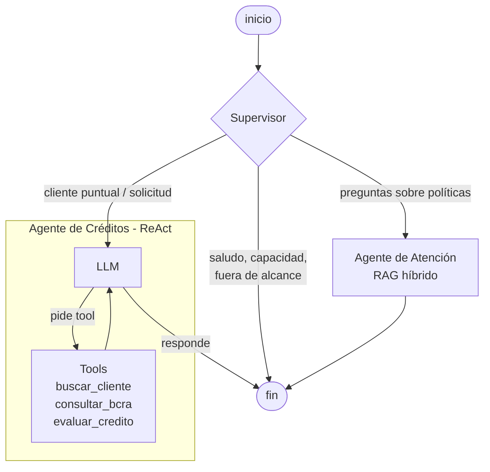

# FintechLab — Intelligence System

Trabajo final del curso **AI Engineer**. Asistente virtual de una financiera ficticia,
**FintechLab**, que ofrece préstamos personales. Integra:

- **RAG híbrido** sobre las políticas de la empresa (agente de Atención)
- **Agentes con patrón Supervisor** en LangGraph (Supervisor → Atención / Créditos)
- **API profesional** con FastAPI, validada con Pydantic y documentada con OpenAPI
- **Memoria persistente** de conversaciones con el Checkpointer de LangGraph sobre Redis
- **Trazabilidad completa** en LangSmith
- **Despliegue local con una sola instrucción** (Docker Compose)

Todo el código de acceso a LLMs, bases de datos y APIs externas es **asíncrono**.

---

## Arquitectura

### Grafo de agentes



| Componente | Qué hace |
|---|---|
| **Supervisor** | Decide quién atiende cada mensaje con *structured output* (Pydantic `Ruteo`). Las preguntas de capacidad ("¿en qué me podés ayudar?") se resuelven con una heurística, sin gastar LLM. |
| **Agente de Atención** | RAG sobre `data/policies/`. Recuperación híbrida (embeddings + BM25 fusionados con RRF) y guardrail: si ningún fragmento es suficientemente relevante, no llama al LLM y responde con cautela. |
| **Agente de Créditos** | Subgrafo ReAct con 3 tools validadas con Pydantic. La **decisión** de un crédito la toma un motor determinístico (`scoring.py`), nunca el LLM: el LLM conversa y explica. |
| **Checkpointer** | Redis (`AsyncRedisSaver`). Cada conversación se identifica con un `thread_id` y sobrevive a reinicios del servidor. |

### Flujo de una consulta

```
Cliente ──HTTP──► FastAPI (/chat) ──► Grafo LangGraph ──► Supervisor ──► Agente
                       │                     │                              │
                       │                     └── Checkpointer (Redis) ◄─────┤
                       │                                                    ├── SQLite (clientes)
                       └──────────── trazas ──► LangSmith ◄─────────────────┴── BCRA (real o simulado)
```

### Estructura del repositorio

```
├── agents/
│   ├── supervisor.py         # Grafo principal: Supervisor + nodos
│   ├── atencion/
│   │   ├── ingest.py         # Indexa las políticas (fragmentos + embeddings)
│   │   ├── rag.py            # Recuperación híbrida + guardrail + respuesta
│   │   └── schemas.py
│   └── creditos/
│       ├── agent.py          # Subgrafo ReAct del agente de Créditos
│       ├── tools.py          # buscar_cliente, consultar_bcra, evaluar_credito
│       ├── scoring.py        # Motor determinístico de la política de créditos
│       ├── bcra.py           # Cliente async de la Central de Deudores (real / mock)
│       ├── db.py             # Acceso async a la base (aiosqlite)
│       ├── seed.py           # Genera 40 clientes sintéticos
│       └── schemas.py
├── api/
│   ├── main.py               # FastAPI: endpoints
│   ├── schemas.py            # Request/Response validados
│   └── checkpointer.py       # Redis (o SQLite como respaldo local)
├── scripts/probar_sistema.py # 8 pruebas de punta a punta (trazadas en LangSmith)
├── data/policies/            # Políticas de FintechLab (fuente del RAG)
├── Dockerfile · docker-compose.yml · run.sh
└── .env.example
```

---

## Cómo levantarlo

### Opción A — Docker (recomendada, una sola instrucción)

Requisitos: Docker Desktop y una API key de OpenAI.

```bash
cp .env.example .env      # en Windows: copy .env.example .env
# completar OPENAI_API_KEY y LANGSMITH_API_KEY en .env
./run.sh                  # o directamente: docker compose up --build
```

Al arrancar, el contenedor genera la base sintética y el índice del RAG (solo la primera vez).
La API queda en **http://localhost:8000** y la documentación en **http://localhost:8000/docs**.

### Opción B — Local, sin Docker

```bash
python -m venv venv
venv\Scripts\activate                # Linux/Mac: source venv/bin/activate
pip install -r requirements.txt
python -m agents.creditos.seed       # base de clientes
python -m agents.atencion.ingest     # índice del RAG
python -m uvicorn api.main:app --reload
```

Sin `REDIS_URL`, el Checkpointer usa SQLite local (`data/checkpoints.db`): las
conversaciones también persisten entre reinicios.

---

## API

| Método | Ruta | Descripción |
|---|---|---|
| `POST` | `/chat` | Envía un mensaje. Devuelve la respuesta, qué agente respondió, tools usadas, fuentes del RAG y latencia. |
| `GET` | `/chat/{thread_id}/historial` | Conversación guardada en el Checkpointer. |
| `POST` | `/creditos/evaluar` | Evalúa una solicitud directamente con el motor de política (sin LLM). |
| `GET` | `/health` | Estado del servicio y checkpointer en uso. |

Ejemplo:

```bash
curl -X POST http://localhost:8000/chat -H "Content-Type: application/json" \
  -d '{"mensaje": "¿Puedo cancelar mi préstamo antes de tiempo?", "thread_id": "demo-1"}'
```

```json
{
  "thread_id": "demo-1",
  "respuesta": "Sí, podés cancelarlo de forma anticipada sin penalidades...",
  "agente": "atencion",
  "ruta": "rag",
  "tools_usadas": [],
  "fuentes": [{"fuente": "preguntas_frecuentes.md", "seccion": "¿Puedo cancelar mi préstamo de forma anticipada?", "similitud": 0.71}],
  "latencia_ms": 1830
}
```

---

## Observabilidad (LangSmith)

Con `LANGSMITH_TRACING=true` y `LANGSMITH_API_KEY` en el `.env`, cada request queda
trazado: ruteo del Supervisor, recuperación del RAG (fragmentos y puntajes), llamadas al
LLM, tools ejecutadas con sus argumentos y resultados. Cada traza lleva el `thread_id`
como metadato para filtrar por conversación.

Pruebas de punta a punta (con la API levantada):

```bash
docker compose exec api python -m scripts.probar_sistema   # con Docker
python -m scripts.probar_sistema                           # local
```

| # | Caso | Camino esperado |
|---|---|---|
| 1 | "¿En qué me podés ayudar?" | Supervisor → directo (sin LLM) |
| 2 | Pregunta cubierta por las políticas | Atención → RAG |
| 3 | Pregunta no cubierta | Atención → guardrail, sin inventar |
| 4 | Solicitud de un cliente apto | Créditos → `evaluar_credito` → aprobado |
| 5 | "¿Y si lo pido a 24 meses?" (mismo thread) | Créditos, usando la memoria del Checkpointer |
| 6 | Cliente en situación 3 del BCRA | Créditos → revisión manual (escalamiento humano) |
| 7 | Cliente en situación 4+ del BCRA | Créditos → rechazo automático |
| 8 | Tema ajeno | Supervisor → directo, declina con amabilidad |

Los resultados se guardan en `evidencia/resultados_pruebas.json`.

---

## Decisiones de diseño

- **El LLM no decide créditos.** `scoring.py` aplica la política de forma determinística y
  auditable (devuelve cada chequeo realizado). El agente solo conversa y comunica el resultado.
- **BCRA simulado por defecto** (`BCRA_MODO=mock`). Los CUITs son sintéticos: consultarlos
  en la API real podría devolver datos de una persona real que coincida por azar. El modo
  simulado además hace las pruebas reproducibles y no depende de la disponibilidad del BCRA.
  `BCRA_MODO=real` usa la API pública, con reintentos ante errores 5xx.
- **Índice del RAG en JSON.** El corpus es chico (13 fragmentos); una base vectorial sumaría
  un servicio sin beneficio a esta escala. La búsqueda está aislada en `rag.py`.
- **Fragmentación por sección** del markdown, con título del documento y sección como
  metadatos: cada regla queda junto a su contexto.
- **Errores externos como datos**: si el BCRA falla, la tool devuelve el error y la
  política deriva el caso a un analista en lugar de romper la conversación.
- **Nada hard-codeado**: modelos, URLs, umbrales y parámetros vienen de variables de entorno.

## Limitaciones conocidas y extensiones

- No hay integración con AFIP (solo se valida el formato del CUIT).
- Cheques rechazados del BCRA: no se consultan todavía.
- La tasa de referencia del BCRA es un parámetro (`TASA_REFERENCIA_ANUAL`), no un dato en vivo.
- Extensiones previstas: agentes de Fraude y Cobranzas, streaming de respuestas, alta de clientes.
